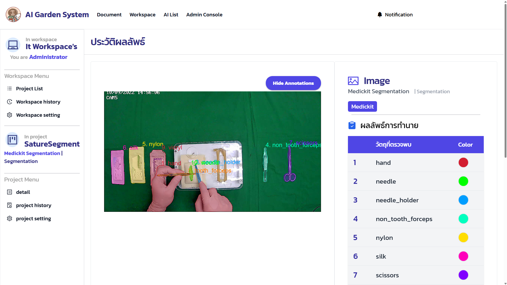
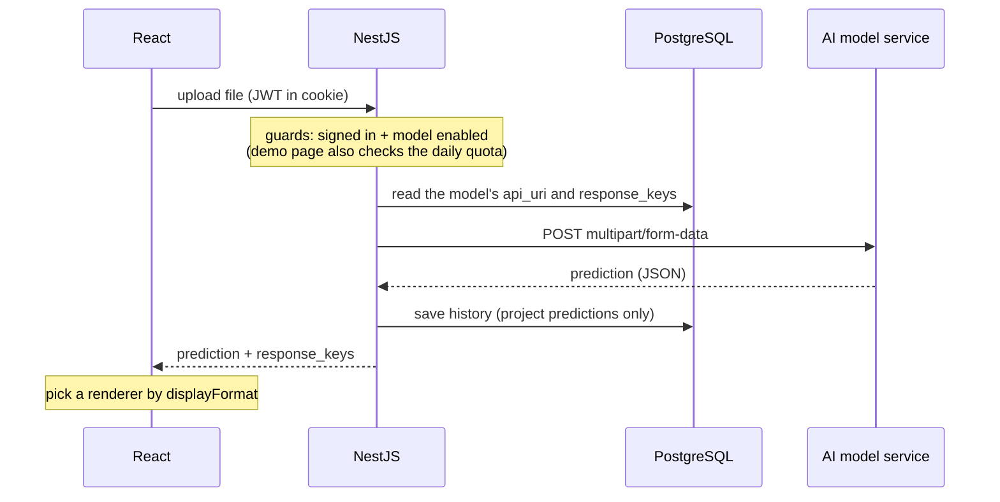
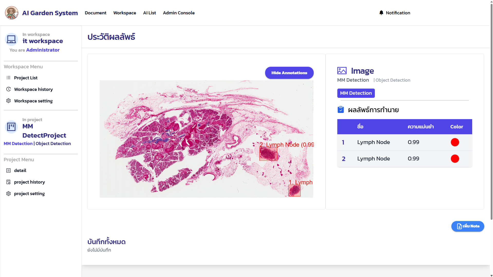
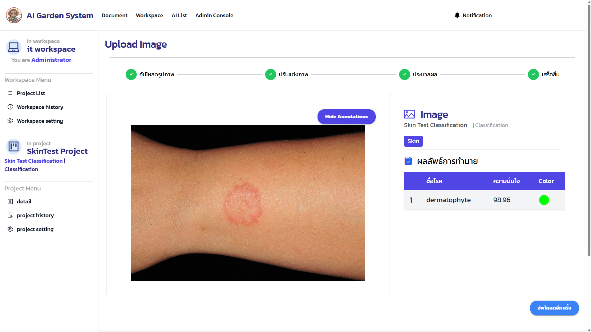

# AI-garden-System

**Web Application to Support Image Analysis with AI Computer Vision in a Microservice Model**


<!-- TODO: CI badge (no GitHub Actions workflow yet) -->
<!-- TODO: CodeQL badge (no CodeQL workflow yet) -->
<!-- TODO: License badge (no LICENSE file yet) -->

A central hub for computer vision models. Each AI model runs as its own
microservice; an admin plugs it into the system by entering its URL, **without
changing any code**. Users then reach every model through one UI with sign-in
and permissions, upload images or videos, and see the results drawn on the
image, instead of calling each model's endpoint by hand.

Supports **object detection, segmentation, regression and classification**.



Built as a team senior project and used in real lab experiments by AI
research students.

## Features

The system runs on a private internal server, so there is no public demo.

- **Model demo:** pick a model from the AI list and try it on an image, no project needed.
- **Edit before predicting:** crop, rotate, resize, pad or grayscale the image in the browser.
- **Teams:** invite members to a workspace with a link or a QR code.
- **Private projects:** limit a project to members who were granted access.
- **History and stats:** every prediction made in a project is kept, with usage statistics.
- **Admin panel:** add or disable models, approve who may use them, set daily quotas, view the dashboard.

## How a prediction works



## Adding an AI model

1. **Wrap the model as a service** that accepts a `multipart/form-data` upload in
   the field `file` and answers with JSON.
2. **Deploy the service** on a server the backend can reach.
3. **Connect it in the admin panel:** enter the service URI and upload a sample
   file. The system sends it to the service and lists every key in the JSON reply.
4. **Map the response keys** to the system's display formats and give each a
   label. The preview updates while you map; once saved, users can run the model.

| displayFormat | Expected value at that key | Shown as |
|---|---|---|
| `objectdetection` | `[{ label, confidence, position: { x1, y1, x2, y2 } }]` | boxes on the image |
| `segmentation` | `[{ label, polygons: [[[x, y], ...]] }]` | filled polygons on the image |
| `chart` | `[number, ...]` | line chart |
| `text` | any value | labeled text |

## Tech stack

| Layer | Choice | Role here |
|---|---|---|
| Frontend | React 18, Vite, TypeScript, React Router 6 | Pages, components and hooks grouped by feature |
| Server state | TanStack Query 5 | 5-minute cache; refetches only the history and stats a prediction changed |
| Forms | React Hook Form + Zod | Validates the model, workspace and project forms before sending |
| UI | MUI 6, Tailwind CSS 3, Ant Design Icons | MUI for components, Tailwind for layout |
| AI results | Canvas API + Chart.js | Boxes and polygons drawn on the image; charts for regression and the dashboard |
| In-app docs | TinyMCE | User guide edited from the web |
| Backend | NestJS 10 | One module per domain; guards check access |
| Auth | Passport Google OAuth 2.0 + JWT | Google sign-in; JWT kept in an HttpOnly cookie |
| Database | PostgreSQL 17 + TypeORM | Predictions stored whole as `jsonb` |
| Uploads | Multer | Keeps uploaded files for the history pages |
| Deploy | Docker Compose + Nginx | Nginx serves the React build and proxies `/api` to NestJS |

## App shell

```
+-----------------------------------------------------------------+
| Logo  Document  Workspace  AI List  Admin Console*  (bell) (me) |
+-------------------+---------------------------------------------+
| PROJECT           |  Predict: upload > process > result         |
|   Detail          |                                             |
|   History         |  +--------------------------+-------------+ |
|   Setting**       |  | image + boxes / polygons | result keys | |
| WORKSPACE         |  |                          |             | |
|   Project List    |  +--------------------------+-------------+ |
|   History         |                                             |
|   Setting**       |                                             |
+-------------------+---------------------------------------------+
  * admin only   ** workspace owner or admin
  The PROJECT menu appears only inside a project.
```

<details>
<summary>Routes</summary>

```
/                                       home, Google sign-in
/docs[/:docsId[/:subDocsId]]            user guide
/ai-list, /ai/:id/detail, /ai/:id/demo  models, details, demo
/workspaces                             my workspaces and invitations
/invite?token=...                       join from an invite link
/workspaces/:ws/project-list            projects in a workspace
/workspaces/:ws/history                 history across projects
/workspaces/:ws/setting/edit            workspace settings (owner)
/workspaces/:ws/setting/invitation      invite members (owner)
/workspaces/:ws/create                  new project (owner)
/workspaces/:ws/project/:p/predict      upload and predict
/workspaces/:ws/project/:p/detail       project statistics
/workspaces/:ws/project/:p/history      history (+ /detail/:id)
/workspaces/:ws/project/:p/setting      project settings (owner)
/workspaces/:ws/project/:p/setting/access  per-member access (owner)
/admin/dashboard                        usage overview
/admin/admin-ai, /admin/createai, /admin/updateai/:id   manage models
/admin/userlist, /admin/user/:id        users and their model access
/admin/workspace                        all workspaces
```

</details>

## Code worth reading

- **New models without new code.** The add-model page walks the sample JSON two
  levels deep to offer key paths ([`CreateAiPage.tsx`](ReactFrontend/src/pages/Admin/CreateAiPage.tsx)),
  and the model stores only `api_uri` and `response_keys`
  ([`ai-model.entity.ts`](nest-backend/src/ai/entities/ai-model.entity.ts)).
  At display time the dotted path is resolved and the matching renderer chosen
  ([`AIDisPlayResultComponent.tsx`](ReactFrontend/src/components/aiDisplay/AIDisPlayResultComponent.tsx)).
- **Results drawn on the image.** Boxes with confidence and segmentation
  polygons use each model's color set and can be toggled
  ([`ImageDetectionResultDraw.tsx`](ReactFrontend/src/components/aiDisplay/ImageDetectionResultDraw.tsx)).
- **Three levels of access.** System role (user/admin), workspace role
  (owner/member), then project access: admins and owners pass, members need a
  grant when the project is private
  ([`project-permission.guard.ts`](nest-backend/src/projects/guards/project-permission.guard.ts)).
  Project routes in React are wrapped in the same three guards
  ([`router.tsx`](ReactFrontend/src/routes/router.tsx)).
- **Controlled model use.** An admin can switch a model off at once, and the demo
  page caps calls per user, per model, per day, with an adjustable limit
  ([`ai-setting/guards/`](nest-backend/src/ai-setting/guards/)). Users must be
  approved for a model before they can pick it for a project.
- **Invite links that can't be forged.** Signed JWTs with their own
  `INVITE_SECRET`, valid for 7 days, downloadable as a QR code
  ([`workspaces.service.ts`](nest-backend/src/workspaces/workspaces.service.ts)).

## Screens

**Object detection:** boxes with confidence, one color per class



**Classification:** predicted class and confidence



<!-- TODO: more screens, e.g. AI model list, project statistics, admin dashboard -->

## Getting started

Needs Node 18+, PostgreSQL 17 and a Google OAuth client
([Google Cloud Console](https://console.cloud.google.com/apis/credentials)).
Docker is optional.

```bash
git clone https://github.com/aumputthipong/AI-garden-System.git
cd AI-garden-System
cp .env.example .env    # root: Postgres credentials for docker compose
```

Create `nest-backend/.env`:

```
POSTGRES_HOST=localhost   # host.docker.internal when the backend runs in Docker
POSTGRES_PORT=5432
POSTGRES_USER=postgres
POSTGRES_PASSWORD=<your password>
POSTGRES_DATABASE=ai_garden_db

GOOGLE_CLIENT_ID=<from Google Cloud Console>
GOOGLE_SECRET=<from Google Cloud Console>
JWT_SECRET=<long random string>      # signs sign-in tokens
INVITE_SECRET=<long random string>   # signs workspace invite links

NODE_ENV=development
REACT_APP_API_URL=http://localhost:5173   # frontend URL: CORS, post-login redirect, invite links
NEST_APP_API_URL=http://localhost:3000    # backend URL: Google OAuth callback
```

Create `ReactFrontend/.env`:

```
VITE_NEST_BACKEND_API_URL=http://localhost:3000
```

Run (frontend http://localhost:5173, backend http://localhost:3000):

```bash
# with Docker (Postgres runs on your machine; first build takes about 5 minutes)
docker compose -f docker-compose.dev.yml up --build

# or without Docker, in two terminals
cd nest-backend && npm install && npm run start:dev
cd ReactFrontend && npm install && npm run dev
```

> **Careful:** `synchronize: true` in
> [`typeorm.ts`](nest-backend/src/config/typeorm.ts) makes TypeORM reshape the
> tables to match the entities on every start. A column missing from an entity is
> **dropped with its data**, so back up before switching branches or editing entities.

## Production and security

`docker-compose.prod.yml` runs PostgreSQL, NestJS and Nginx (serving the React
build). Data lives in the `db-data` volume, and the backend waits for the
database health check before it starts.

- **Token in an HttpOnly cookie,** not localStorage, so page scripts can't read it.
  The cookie is `Secure` and expires after 7 days.
- **Google sign-in only,** so the system stores no passwords.
- **CORS limited to the frontend origin,** with credentials allowed only there.
- **One domain for the app and the API:** Nginx proxies `/api` to NestJS and caps uploads at 50 MB.
- **HTTPS** ends at the reverse proxy in front of the server, which redirects
  HTTP to HTTPS and forwards to the app's Nginx on port 80.

## Project structure

```
.
├── nest-backend/         # NestJS API (port 3000)
│   └── src/
│       ├── auth/         # Google OAuth + JWT
│       ├── ai/           # AI model registry + predict proxy
│       ├── ai-setting/   # usage limit / visibility guards
│       ├── permission/   # admin approves user access to AI
│       ├── workspaces/   # workspace + members
│       ├── projects/     # project inside workspace
│       ├── user/
│       ├── docs/         # document editor
│       └── note_history/
│
├── ReactFrontend/        # React + Vite (port 5173)
│   └── src/
│       ├── pages/        # main pages grouped by feature
│       ├── components/
│       ├── api/          # axios + endpoint definitions
│       ├── hook/         # TanStack Query hooks
│       └── ...
│
├── docker-compose.dev.yml
├── docker-compose.prod.yml
└── .env.example
```
